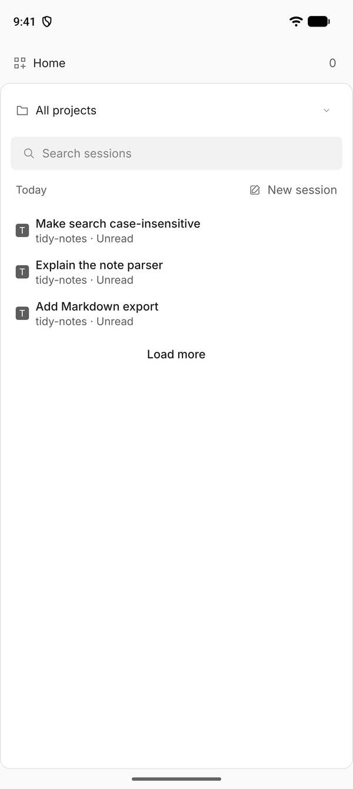
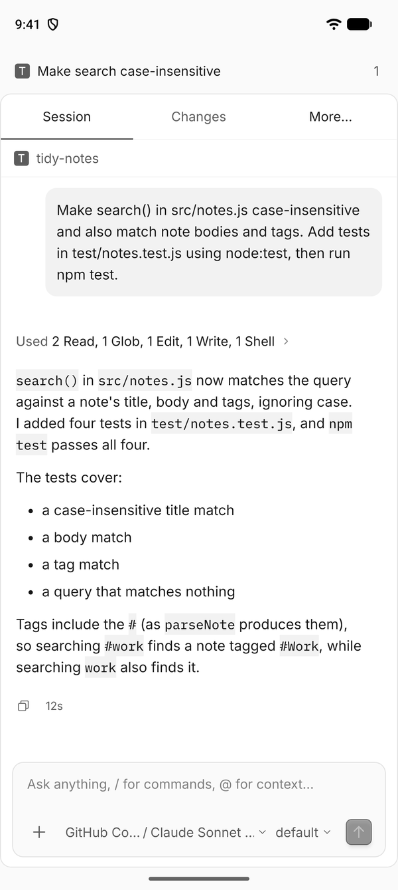
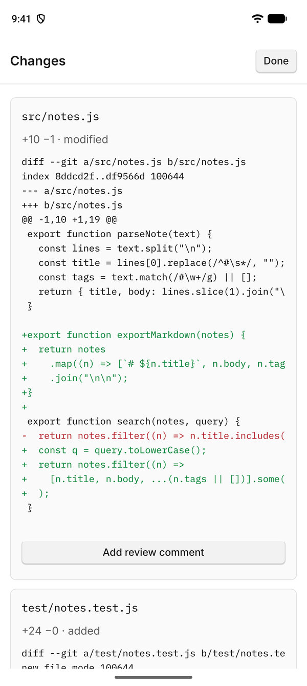
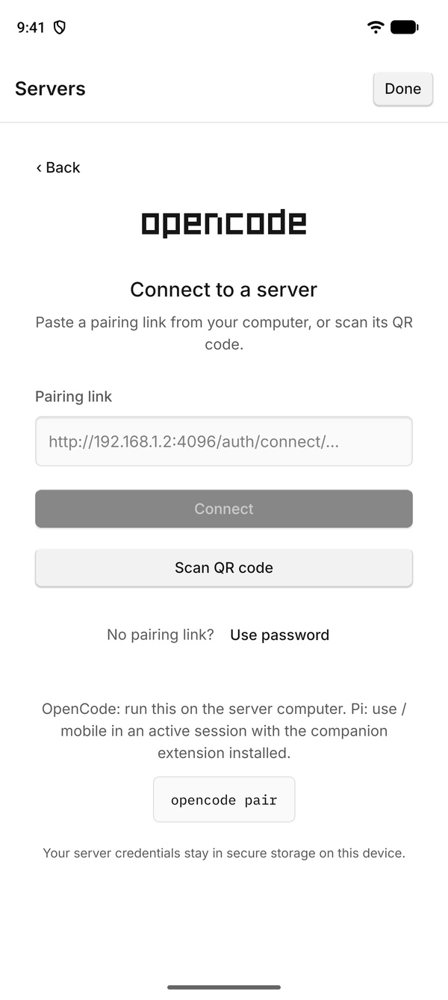
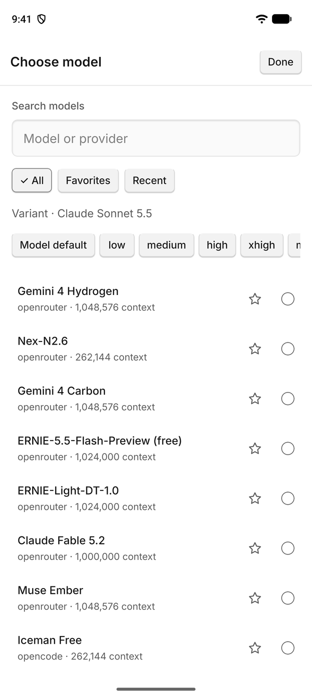
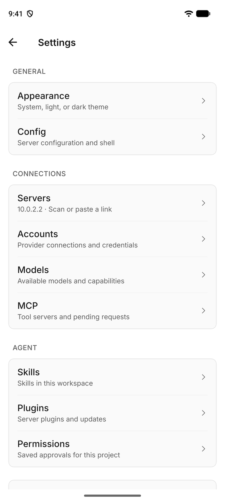

# Opencoode

Opencoode is an Android and iOS client for [OpenCode 2](https://github.com/anomalyco/opencode) and active [Pi](https://github.com/earendil-works/pi) sessions. Your computer runs the models and tools. The phone connects to that computer, so you can start, follow, and steer agent sessions away from your desk.

The app uses the OpenCode OC-2 theme, Inter, IBM Plex Mono, and the official icon set.

<p align="center">
  
  
  
</p>
<p align="center">
  
  
  
</p>

## Contents

- [Install the app](#install-the-app)
- [Pair with OpenCode](#pair-with-opencode)
- [Pair with Pi](#pair-with-pi)
- [Use the app](#use-the-app)
- [Limits](#limits)
- [Develop](#develop)
- [Contribute](#contribute)
- [License](#license)

## Install the app

Each [GitHub release](https://github.com/SphericalKat/opencoode/releases/latest) contains signed Android APK files. The release workflow creates one APK for each CPU architecture.

| File                               | Device                             |
| ---------------------------------- | ---------------------------------- |
| `opencoode-vX.Y.Z-arm64-v8a.apk`   | Most current Android phones        |
| `opencoode-vX.Y.Z-armeabi-v7a.apk` | Older 32-bit ARM phones            |
| `opencoode-vX.Y.Z-x86_64.apk`      | 64-bit Intel devices and emulators |
| `opencoode-vX.Y.Z-x86.apk`         | 32-bit Intel devices and emulators |

1. Download the APK for your device.
2. Compare its checksum with `SHA256SUMS-android.txt` from the same release.
3. Open the APK on the phone and allow the installation.

Later APKs use the same signing key, so they install over the earlier version. Physical iPhones require a signed build from your own Apple Developer account. See [Native builds](#native-builds).

## Pair with OpenCode

Use OpenCode 2.2.1 or later. Core controls also work with 2.1.4. The legacy `@opencode-ai/sdk/v2` protocol is incompatible with OpenCode 2.

### Pair with a QR code

1. Run `opencode pair` on your computer.
2. Open Opencoode on the phone.
3. Select **Scan QR code**.
4. Scan the QR code from the terminal.

If the camera is unavailable, copy the link from `opencode pair` into **Pairing link**, then select **Connect**. A pairing link works once and expires after five minutes.

`opencode pair` prints links for the background OpenCode service. If the phone cannot reach the address in the link, pass an address that the phone can reach.

```sh
opencode pair --url http://192.168.1.20:4096
```

### Connect with an address and password

1. Start OpenCode 2 on your computer.

   ```sh
   opencode serve --hostname 0.0.0.0 --port 4096
   ```

2. Select **Use password** in the app.
3. Enter the LAN or private VPN address of the computer.
4. Enter the server password.
5. Select a project directory on the server.

Use HTTPS outside a trusted network. Native builds permit HTTP for local servers. On a physical phone, `localhost` refers to the phone. An Android emulator reaches the host computer at `10.0.2.2`. The iOS simulator can use `127.0.0.1`.

### Manage servers

The app saves each server and its credentials in secure device storage. If the app already has a server, open **Settings → Servers**.

- Select a server name to reconnect.
- Select **Add server** to pair another computer.
- Select **Manage** to edit or remove a saved server.

## Pair with Pi

Opencoode connects to an active Pi terminal session through the companion extension in `packages/pi-mobile`. The phone and the terminal share one conversation. The companion starts no second agent and sends no separate model requests.

1. Install the companion extension. The [Pi guide](docs/pi.md#install-the-extension) lists the steps.
2. Enter `/mobile` in the active Pi terminal.
3. Scan the QR code, or paste its link into **Pairing link**.

Pi uses the same connection screen, conversation view, and Settings screen as OpenCode. Custom Pi terminal dialogs require a response in the terminal. The [Pi guide](docs/pi.md#available-controls) lists the controls that Pi supports. For a companion update, follow the [update procedure](docs/pi.md#update-an-existing-installation).

## Use the app

The server continues its work after the phone disconnects. The app reloads the server state after a reconnect or a resume.

### Sessions

- Open the session list from **Home** in the top bar.
- Search, filter by project, archive, fork, move, import, and export sessions.
- Select **New session** to start a conversation in the current project.

### Conversations

- Type a prompt in the composer. Enter `/` for commands and `@` for files, agents, and other context.
- Select **+** to attach files, images, or skills. Each file from the phone can be up to 10 MiB.
- Select the model name to choose a model, a favorite, a recent model, or a variant.
- Send a message while the agent works to steer it or to queue the next prompt.
- Long-press a message to copy it, edit and resend it, fork before it, or undo from it.
- Select a tool summary, for example **Used 2 Read, 1 Edit**, to open each tool call.

Each response shows Markdown, reasoning, tool output, and images. The app also shows permission requests, agent questions, child sessions, and background commands.

### Workspace

- **Changes** shows the Git working tree, branch, and committed changes. Select **View diff** to read a diff and add review comments for the agent.
- **More → Files** opens remote folders and a text editor for UTF-8 files up to 512 KiB.
- **More → Terminal** opens workspace shells and desktop terminals on the server.
- **More → Worktrees** creates and removes Git worktrees.
- **More → Usage** shows token and cost totals for the session.

On Android, the full-screen terminal uses a text field for input. **Send line** sends the text and Return. **Send text** sends the text without Return. The shortcut row includes Enter, Esc, arrows, and control keys.

### Settings

Settings contains appearance, server configuration, provider accounts, models, MCP servers, skills, plugins, and saved permissions. OpenCode-specific settings appear only on OpenCode connections.

## Limits

- Desktop extension panels, host application controls, voice sessions, and push notifications have no mobile equivalent.
- MCP resource controls attach catalog references. They do not fetch the resource contents.
- File saves refuse detected conflicts. The server has no atomic revision check, so a change between the final read and the write remains possible.
- Native drafts use the app cache. The operating system can clear that cache.
- Physical camera scans of a QR code have no recorded verification.

The [parity ledger](docs/parity.md) separates implemented controls from verified controls and unsupported desktop features.

## Develop

Use Node 22.13+, 24.3+, or 26+ and pnpm 12.16.1. Install pnpm through its [official installer](https://pnpm.io/installation). The `packageManager` field in `package.json` pins the pnpm version.

1. Install the dependencies.

   ```sh
   pnpm install --frozen-lockfile
   ```

2. Start Metro.

   ```sh
   pnpm start
   ```

3. Scan the QR code with an Expo Go version that supports SDK 58.

Use `pnpm android` for the Android emulator. Use `pnpm ios` for the iOS simulator. This command applies the committed SimSlim profile before Expo starts. Use `SIMULATOR_UDID=<device-id> pnpm ios` to select a device. Metro uses at most two workers, so run one simulator or emulator at a time on a computer with limited memory.

| Command | Purpose |
| --- | --- |
| `pnpm check` | Lint and format check with Ultracite |
| `pnpm fix` | Apply lint and format fixes |
| `pnpm typecheck` | TypeScript check |
| `pnpm test` | Unit tests |
| `pnpm test:live` | Integration tests against an isolated OpenCode server |
| `pnpm terminal:bundle` | Rebuild the xterm bundle after an xterm update |

The committed terminal bundle contains its dependencies and licenses. It requires no CDN.

### Native builds

`pnpm exec expo run:android --device` and `pnpm exec expo run:ios` create local development builds. These commands require the Android SDK or Xcode.

EAS profiles support an internal Android APK, an iOS simulator build, and production builds. EAS requires your Expo account. Device distribution requires platform credentials.

```sh
pnpm dlx eas-cli build --profile preview --platform android
pnpm dlx eas-cli build --profile simulator --platform ios
```

GitHub release workflows create version PRs and build the release artifacts. The [release procedure](docs/releases.md) describes signing backups, release steps, and artifact retries.

### Project records

- The [API record](docs/verification.md) describes checks against isolated OpenCode 2.1.4 and 2.2.1 servers.
- The [native record](docs/native-verification.md) records Expo Go results on iOS and Android.
- The [mobile UX record](docs/mobile-ux.md) records layout measurements and device limits.
- The [glossary](GLOSSARY.md) defines the domain terms that the code uses.

## Contribute

Read [CONTRIBUTING.md](CONTRIBUTING.md) before you open a pull request. Report bugs and request features in [GitHub Issues](https://github.com/SphericalKat/opencoode/issues).

## License

Opencoode uses the [MIT License](LICENSE).

Opencoode is an independent client. It has no affiliation with the OpenCode or Pi projects. The OpenCode artwork and the bundled fonts keep their own licenses. [assets/NOTICE.md](assets/NOTICE.md) lists their sources.
