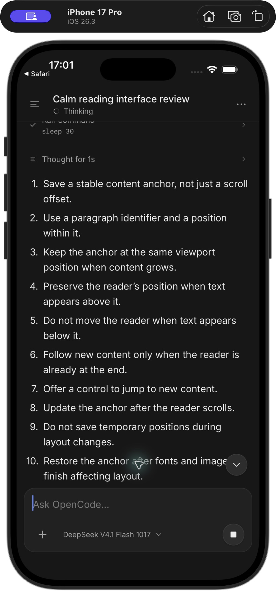
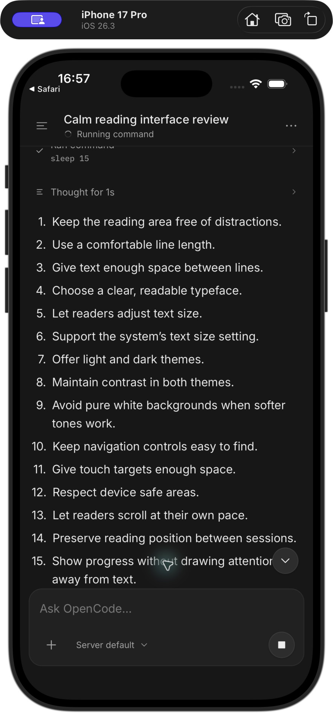
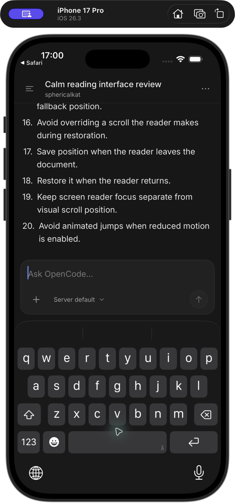

# Agent progress UX

I compared the desktop and TUI source at upstream commit `92b2ca0dd727942e00aba3523ed141d53e78ea28` on October 30, 2026.
I also observed live conversations through the mobile app preview at 393 × 852.

## Comparison

| Area | OpenCode | Previous mobile behavior | My change |
| --- | --- | --- | --- |
| Working | Fallback when no specific activity appears | Generic work label for every active execution | I derived the current phase from events, messages, and requests. |
| Thinking | Unfinished reasoning differs from completed reasoning | Collapsed reasoning card with no live indication | I preserved reasoning timestamps and added live and completed labels. |
| Tools | Separate preparation, execution, and completion | Raw tool name and static pending symbol | I added action labels, a progress indicator, and a command or path preview. |
| Retry | Attempt, countdown, and provider error | Persistent retry text without a countdown | I added the countdown and error details. I cleared stale retries when model output resumes. |
| Requests | Requests replace ordinary work feedback | Generic work feedback remains beside requests | I added an answer or approval state with a Review action. |
| Placement | Stable activity lane and composer activity chips | Activity in the transcript footer | I kept activity inline and in the header. I placed actionable waits above the composer. |
| Reading | Activity does not disturb the current view | Expanding details can trigger automatic scroll | I paused automatic follow on expansion and retained disclosure state. |

I retained one Stop control in the composer.
I kept the stopping state until the server confirms that execution ends.
I used a UI-thread rotation for the progress indicator and retained reduced-motion support.
I kept transcript growth and individual text fragments free of entrance animations.

## Sources

- [Desktop fallback rules and stable activity lane](https://github.com/anomalyco/opencode/blob/92b2ca0dd727942e00aba3523ed141d53e78ea28/packages/app/src/session/timeline/message-timeline.tsx#L392-L514)
- [Live thinking projection](https://github.com/anomalyco/opencode/blob/92b2ca0dd727942e00aba3523ed141d53e78ea28/packages/session-ui/src/timeline/projection.ts#L491-L508)
- [TUI activity labels](https://github.com/anomalyco/opencode/blob/92b2ca0dd727942e00aba3523ed141d53e78ea28/packages/tui/src/routes/session/activity-summary.ts#L46-L51)
- [Retry presentation](https://github.com/anomalyco/opencode/blob/92b2ca0dd727942e00aba3523ed141d53e78ea28/packages/session-ui/src/components/session-retry.tsx)
- [Composer activity chips](https://github.com/anomalyco/opencode/blob/92b2ca0dd727942e00aba3523ed141d53e78ea28/packages/app/src/session/composer/activity-chips.tsx#L217-L249)

## Independent review

I requested Claude reviews of the original implementation and the revised code with an actual phone screenshot.
The reviews identified misleading activity states, stale retries, duplicate controls, disclosure scroll jumps, and accessibility gaps.
I addressed these findings in the implementation.

## Live observations

- I observed the original generic work row and duplicate Stop controls.
- I observed a real shell command and the new execution label.
- I observed the transition to text output and the Writing label.
- I expanded command output and retained the selected reading position.
- I observed a real question with two choices and the answer-wait state.
- I scrolled to earlier messages and retained the answer-wait status above the composer.
- I selected Review, answered the question, and observed execution resume and finish.

## Native refinement

I used one iPhone 17 Pro with iOS 26.3 and the committed SimSlim profile.
I inspected live conversations in Expo Go, including a sustained thinking phase and a 30-second command.
I requested a separate visual review of the native screenshots.

| Before | After | Why |
| --- | --- | --- |
| The empty composer retained the height of a long prompt. | I reset the empty input to 44 points and bounded draft growth. | I recovered space for the conversation. |
| Nearby activity rows repeated the same busy status. | I kept activity inline and moved progress into the header while the reader views older messages. | I reduced duplicate visual noise. |
| The idle status strip reserved blank space. | I retained the strip only for connection issues, retries, stopping, errors, and requests. | I removed an empty band above the composer. |
| A centered text button covered the response. | I replaced it with a small circular arrow at the right edge. | I reduced the area that the control covers. |
| Thought and tool rows had large gaps. | I tightened their spacing and removed extra vertical padding. | I made the work history easier to scan. |
| List cells remounted when recycled. | I retained the row and scoped part state to each message. | I reduced unnecessary work during scrolling. |
| New conversations offered earlier messages. | I hid the action when a response contains fewer than one page of messages. | I removed an action with no older content. |

I scrolled to older content during the command and the thinking phase.
I observed the progress label in the header and retained the same reading position through completion.
I returned to the latest response with the arrow.
I also inspected native long-press selection and the layout with the on-screen keyboard.

I ran no automated tests, typechecks, or native builds.
I reviewed retry failures, permission approvals, and native accessibility behavior from source.
I did not measure animation performance on a physical device.
