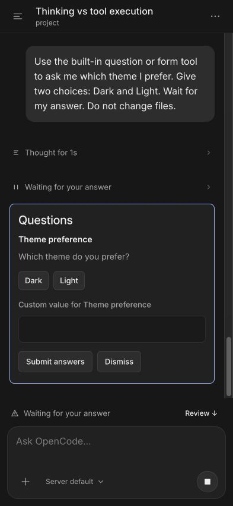

# Agent progress UX

I compared the desktop and TUI source at upstream commit `92b2ca0dd727942e00aba3523ed141d53e78ea28` on October 30, 2026.
I also observed live conversations through the mobile app preview at 393 × 852.

## Comparison

| Area | OpenCode | Previous mobile behavior | My change |
| --- | --- | --- | --- |
| Working | Fallback when no specific activity appears | Generic work label for every active execution | I derived the current phase from events, messages, and requests. |
| Thinking | Unfinished reasoning differs from completed reasoning | Collapsed reasoning card with no live indication | I preserved reasoning timestamps and added live and completed labels. |
| Tools | Separate preparation, execution, and completion | Raw tool name and static pending symbol | I added action labels, a progress indicator, and a command or path preview. |
| Retry | Attempt, countdown, and provider error | Persistent retry text without a countdown | I added the countdown and error details. I cleared stale retries when model output resumes. |
| Requests | Requests replace ordinary work feedback | Generic work feedback remains beside requests | I added an answer or approval state with a Review action. |
| Placement | Stable activity lane and composer activity chips | Activity in the transcript footer | I placed a compact status lane above the mobile composer. |
| Reading | Activity does not disturb the current view | Expanding details can trigger automatic scroll | I paused automatic follow on expansion and retained disclosure state. |

I retained one Stop control in the composer.
I kept the stopping state until the server confirms that execution ends.
I used a UI-thread rotation for the progress indicator and retained reduced-motion support.
I kept transcript growth and individual text fragments free of entrance animations.

## Sources

- [Desktop fallback rules and stable activity lane](https://github.com/anomalyco/opencode/blob/92b2ca0dd727942e00aba3523ed141d53e78ea28/packages/app/src/session/timeline/message-timeline.tsx#L392-L514)
- [Live thinking projection](https://github.com/anomalyco/opencode/blob/92b2ca0dd727942e00aba3523ed141d53e78ea28/packages/session-ui/src/timeline/projection.ts#L491-L508)
- [TUI activity labels](https://github.com/anomalyco/opencode/blob/92b2ca0dd727942e00aba3523ed141d53e78ea28/packages/tui/src/routes/session/activity-summary.ts#L46-L51)
- [Retry presentation](https://github.com/anomalyco/opencode/blob/92b2ca0dd727942e00aba3523ed141d53e78ea28/packages/session-ui/src/components/session-retry.tsx)
- [Composer activity chips](https://github.com/anomalyco/opencode/blob/92b2ca0dd727942e00aba3523ed141d53e78ea28/packages/app/src/session/composer/activity-chips.tsx#L217-L249)

## Independent review

I requested Claude reviews of the original implementation and the revised code with an actual phone screenshot.
The reviews identified misleading activity states, stale retries, duplicate controls, disclosure scroll jumps, and accessibility gaps.
I addressed these findings in the implementation.

## Live observations

- I observed the original generic work row and duplicate Stop controls.
- I observed a real shell command and the new execution label.
- I observed the transition to text output and the Writing label.
- I expanded command output and retained the selected reading position.
- I observed a real question with two choices and the answer-wait state.
- I scrolled to earlier messages and retained the answer-wait status above the composer.
- I selected Review, answered the question, and observed execution resume and finish.

I ran no automated tests, typechecks, or native builds.
I reviewed retry failures, permission approvals, and native accessibility behavior from source.
I did not measure animation performance on a physical device.
